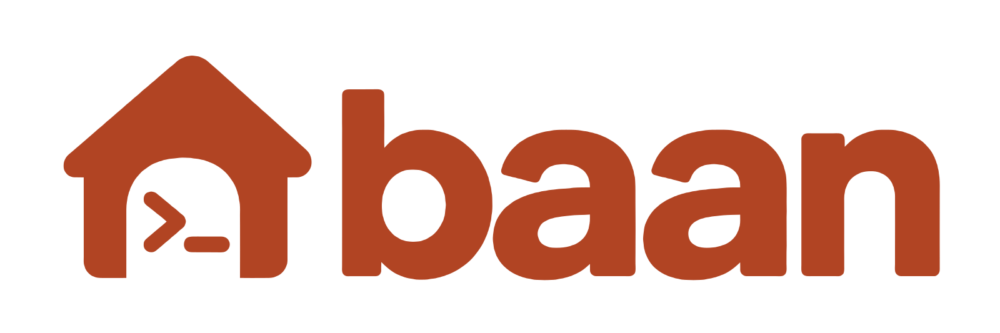

<p align="center"></p>

**baan** lets AI apps like Gemini, Claude or ChatGPT use tools on **your own computer** over the internet, with a login page built in. One codebase for Linux, macOS and Windows.

- **4 built-in tools, same as [pi](https://github.com/earendil-works/pi):** `read`, `write`, `edit`, `bash` (`powershell` on Windows). Each can be turned off.
- **Everything else is a plugin.** The repo ships one: `image`, which lets `read` send pictures at **original resolution, never resized or recompressed**. It adds no new tool, so the AI app's tool list (and its approvals) doesn't change.
- **Built-in login.** Standard MCP OAuth (dynamic client registration + PKCE) with a password page served by baan itself. No Google Cloud project, no GitHub app.
- **Survives restarts.** Stateless MCP + tokens saved to disk, so restarting baan doesn't disconnect your AI app.
- **No hardcoded values.** Everything is in `baan.yml` or env vars.

> ⚠️ **Read this first.** Anyone who logs in can do whatever the enabled tools allow. `bash`/`powershell` = full control of your computer as your user, and it is **not** limited by `workspace.allow`. Plugins run with your full rights too. Keep the password to yourself (setup makes a long random one), keep baan on `127.0.0.1` behind a tunnel, and turn off what you don't need.

## Quick start
You need [Node.js 22.18+](https://nodejs.org) and [Git](https://git-scm.com). Same commands on Linux, macOS and Windows:
```sh
git clone https://github.com/mychicken0/baan-mcp.git
cd baan-mcp
npm install
npm start
```
That's it. `npm start` walks you through everything, with colors and icons, and you mostly just press Enter:

1. **Folder** the AI may work in (default: your home folder).
2. **What it may do:** ⭐ everything like pi: read, write, edit and run commands (recommended) / files only / read only.
3. **Internet address.** No domain needed: baan sets up **Tailscale Funnel** for you. It installs Tailscale if missing (Linux), opens the free sign-in page in your browser, turns Funnel on, and finds your `https://<computer>.<tailnet>.ts.net` address itself. Already have Cloudflare Tunnel or your own domain? Pick that instead.
4. **Keep it running:** ⭐ always, in the background, and **start with the computer** (recommended) / only while the window is open.
5. **Password** is made for you.

At the end it prints the URL to paste into your AI app (also copied to the clipboard) and the password for the login page. In background mode you can then **close the window**: baan keeps running and comes back by itself after a reboot. No admin rights needed:

| OS | How it starts with the computer |
|---|---|
| Linux | systemd user service (`~/.config/systemd/user/baan.service`). With "linger" on (setup offers it) it starts at boot, before anyone logs in. No systemd: desktop autostart at login. |
| macOS | launchd agent (`~/Library/LaunchAgents/com.baan.mcp.plist`), at login |
| Windows | hidden launcher in the Startup folder, at login. No console window |

Picked "only while the window is open"? Press **b** in the baan window any time to move it to the background.

**Changing things later:** edit the config (`npm run config`, or press **c** in the baan window) and save. baan checks it and **restarts by itself**. It does the same when a plugin's code changes. If the new config is broken, the old server keeps running and you see the error. This works in the background too. Keys in the baan window: **b** run in background, **p** control panel, **r** restart, **c** edit config, **g** guide, **q** quit.

### 🏠 Control panel (an app with buttons)
Setup puts a **baan** icon with the house logo in the baan folder, made for your OS: `baan.desktop` (Linux), `baan.app` (macOS) or `baan.lnk` (Windows). Double-click it, even when every window is closed, and the control panel opens in its own window:

- status, the URL for your AI app (📋 copy), whether it starts with the computer
- **Start / Stop / Restart**, and **Run in background** for a baan running in a terminal
- settings: folder, what the AI may do, plugins, port. Save checks everything first, then baan restarts by itself
- make a new password, read the log, open the config file or this guide

It also opens with `npm run panel` or key **p** in the baan window. No icon (set up before it existed, or moved the folder)? `npm run app` makes it. You can drag the icon to your desktop, dock or taskbar.

The panel is for this computer only: it listens on `127.0.0.1` on its own port (baan's port + 1), never on the MCP port that Tailscale Funnel / your tunnel exposes, and every request needs a random key that only the icon knows. It closes by itself when its window is closed; closing it never stops baan.

📖 **[GUIDE.md](GUIDE.md)**: change settings, add or remove plugins, write your own plugin, troubleshooting.

## Commands
| | |
|---|---|
| `npm start` (`baan start`) | first run: guided setup. Then run, and restart by itself on changes |
| `npm run setup` (`baan setup`) | run the guided setup again |
| `npm run background` (`baan background`) | run in the background and start with the computer |
| `npm stop` (`baan stop`) | stop the background copy; it no longer starts with the computer |
| `npm run status` (`baan status`) | running? URL, config and log location |
| `npm run logs` (`baan logs`) | last lines of the background log |
| `npm run panel` (`baan panel`) | open the control panel window |
| `npm run app` (`baan app`) | make the **baan** icon in the baan folder (opens the control panel) |
| `npm run config` (`baan config`) | open the config file in an editor |
| `npm run check` (`baan check`) | check the config and load every plugin, without starting |
| `npm run passwd` (`baan passwd`) | new random password; signs out every connected app |
| `baan init [--public-url URL] [--port N] [--tools a,b] [--password-file F]` | create config + password without questions (scripts) |
| `baan serve` | run once, no auto-restart (for services and scripts) |
| `baan tools` | list enabled tools |

Every command takes `--config FILE`. Env overrides: `BAAN_CONFIG`, `BAAN_DATA_DIR`, `BAAN_HOST`, `BAAN_PORT`, `BAAN_PUBLIC_URL`.

## Getting a public https URL
baan only listens on `127.0.0.1`; the AI app reaches it through a tunnel. The URL must **not change** (a changing URL disconnects your AI app).
- **Tailscale Funnel** (default in setup, no domain): setup runs `tailscale funnel --bg --https=443 http://127.0.0.1:<port>`. If port 443 is already used by another Tailscale service, it uses 8443 or 10000 instead and never overwrites it. The first time, Tailscale asks you to allow Funnel in the browser.
- **Your own domain** (Cloudflare Tunnel, reverse proxy): point it at `http://127.0.0.1:<port>` and enter the address in setup.

## Plugins
Full how-to in [GUIDE.md](GUIDE.md#plugins).
```yaml
plugins:
  image: { from: baan-plugin-image, maxBytes: 20971520 }   # bundled package in plugins/image
  mytool: { from: ./my-plugin.ts }     # local file
  other: { from: some-npm-package }    # installed package (must ship JS)
  image: false                         # keep installed, turn off
```
A plugin's default export is a factory. It receives `z` (zod), so it needs no dependencies:
```ts
import type { PluginFactory } from "baan-mcp/src/plugin.ts";

const plugin: PluginFactory = ({ z, options }) => ({
  name: "hello",
  tools: [{
    name: "hello",
    description: "Say hello",
    input: { name: z.string() },
    readOnly: true,
    run: async ({ name }, ctx) => `hello ${name}`,   // or [{type:"text"...},{type:"image"...}]
  }],
});
export default plugin;
```
`ctx.resolvePath(p)` expands `~`, resolves relative paths and enforces `workspace.allow`.

### `image` plugin
With it on, `read` on a picture checks the file's real format (PNG, JPEG, GIF, WebP), reads its width × height from the header, and sends the bytes **unchanged**. Files over `maxBytes` are refused instead of shrunk. (The AI app may still scale images on its own side; baan never does.)

## Security notes
- Password is stored as a scrypt hash; access/refresh tokens are stored as SHA-256 hashes in `state.json` (mode 600).
- Login page locks after `auth.maxFailedLogins` wrong passwords for `auth.lockoutSec`.
- Every tool call is appended to `audit.log` (long arguments clipped).

## Development
```sh
npm run typecheck
npm test          # end-to-end: OAuth flow + all tools + image bytes unchanged
```

## Status
Early prototype. Planned: a setup page in the browser, `baan plugin add/remove`, single-file installers.

Inspired by [pi](https://github.com/earendil-works/pi) (minimal tool set) and DeepSeek Harness (everything is a plugin). Not affiliated with either.
